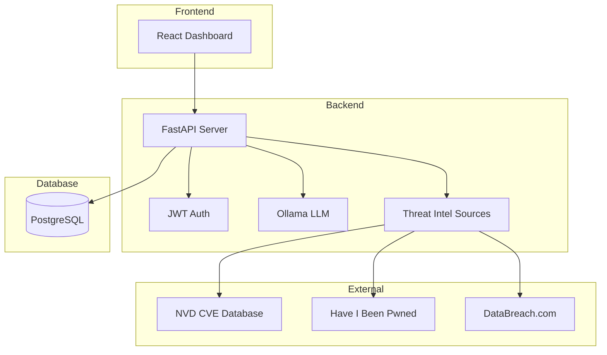

# Security Posture Agent

A comprehensive cybersecurity platform for monitoring third-party vendor risks, CVE correlations, and threat intelligence analysis.

## Overview

Security Posture Agent helps organizations:
- Track and assess third-party vendor relationships with business-specific risk scoring
- Automatically correlate CVEs with technology stacks
- Ingest and analyze threat intelligence from multiple sources
- Extract technology dependencies from architecture documents
- Generate AI-powered risk assessments and recommendations
- Receive real-time alerts for vulnerabilities and security incidents
- Produce automated weekly security posture summaries

## Architecture



## Tech Stack

### Backend
- **Framework**: FastAPI
- **Database**: PostgreSQL 14+
- **Authentication**: JWT (HS256)
- **AI/ML**: Ollama (qwen2.5:0.5b, phi3:mini)
- **Testing**: unittest

### Frontend
- **Framework**: React 18
- **Build Tool**: Vite
- **Styling**: TailwindCSS
- **Charts**: Recharts
- **Graphs**: react-force-graph-2d
- **Icons**: Lucide React

## Prerequisites

- PostgreSQL 14 or higher
- Python 3.9+
- Node.js 18+
- Ollama (optional, for AI features)

## Quick Start

### 1. Database Setup

Copy `backend/.env.example` to `backend/.env` and configure:

```env
# REQUIRED
JWT_SECRET=your_jwt_secret_key_here_change_this
DB_PASSWORD=your_database_password

# Database
DB_HOST=localhost
DB_PORT=5432
DB_NAME=ai_tip
DB_USER=postgres
```

Initialize the database:

```powershell
python backend/scripts/setup_database.py
```

### 2. Backend Setup

```bash
cd backend
pip install -r requirements.txt
uvicorn app.main:app --reload --host 0.0.0.0 --port 8000
```

### 3. Frontend Setup

```bash
cd frontend
npm install
npm run dev
```

Access the application at http://localhost:5173

## Configuration

### Environment Variables

See `backend/.env.example` for all available configuration options:

- **JWT_SECRET** (required): JWT signing key
- **Database**: DB_HOST, DB_PORT, DB_NAME, DB_USER, DB_PASSWORD
- **AI**: OLLAMA_URL, OLLAMA_MODEL, OLLAMA_TIMEOUT
- **Email**: RESEND_API_KEY, SMTP_HOST, SMTP_USER, SMTP_PASSWORD
- **Threat Intel**: DATABREACH_API_KEY, HIBP_API_KEY, LEAKCHECK_API_KEY

## Database Schema

The authoritative schema is in `database/schema.sql`. Sample seed data is in `database/seed_sample.sql`.

## API Documentation

Once the backend is running:
- Swagger UI: http://localhost:8000/docs
- ReDoc: http://localhost:8000/redoc

## Testing

```bash
cd backend
python -m unittest discover tests -v
```

## Project Structure

```
security-posture-agent/
├── backend/              # FastAPI backend
│   ├── app/             # Application modules
│   ├── tests/           # Unit tests
│   ├── migrations/      # Database migrations
│   └── scripts/        # Utility scripts
├── frontend/            # React frontend
│   ├── src/
│   │   ├── components/  # React components
│   │   └── api/         # API client
├── database/            # Database files
│   ├── schema.sql       # Authoritative schema
│   └── seed_sample.sql  # Sample data
└── docs/                # Documentation
```

## Security Notes

- Never commit `.env` files or credentials
- Use strong, random JWT_SECRET values in production
- Database backups are gitignored
- Change default demo credentials before deployment

## License

MIT License - see LICENSE file for details
